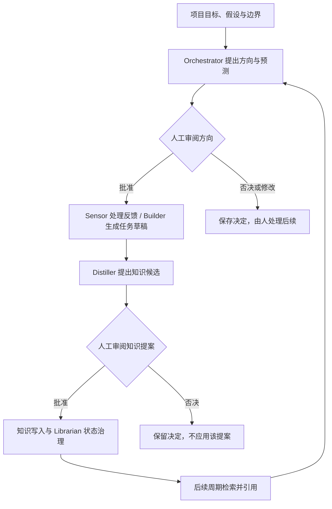

# Alaya · 本地 Agent 工作流与评测研究原型

**把一次 AI 建议，变成可以检查预测、审批、知识变化和执行边界的完整记录。**

Alaya 将项目目标、预测、任务草稿、反馈、知识提案、人工审批和后续引用放在同一个本地工作流里。你可以亲手走完一轮操作，查看知识在什么时候被写入、下一轮引用了什么，以及哪些动作由人批准、哪些只是模拟。

对开发者，它是一份可运行的 Agent 治理实现参考；对研究者，它保留了一组关于记忆、反馈和代码搜索的实验材料，包括失败、受阻、作废和停止的结果。

**当前版本：[v0.1.0-research.1](https://github.com/amanayayatu-tech/Alaya/releases/tag/v0.1.0-research.1)。项目已完成研究版收尾，进入维护模式。** 现有实验尚未证明 Alaya 能带来稳定认知增强；这不影响你用它学习工作流、检查治理机制或复核保存的结果，但不能把它当成已经验证有效的“自主公司大脑”。

[开始使用](#quickstart) · [亲手走完一轮](#walkthrough) · [查看实现](#implementation) · [实验结果](#research) · [常见问题](#faq)


*图中是内置模拟项目。页面展示知识积累、引用和审批状态；这些数字不是任务正确率或认知增强评分。*

## 它对你有什么用？

Alaya 当前最具体的价值，是把 Agent 系统里容易混在一起的几件事拆开，让你可以实际操作、检查和复用。

| 如果你正在做什么 | 可以怎样使用 Alaya | 你能拿到什么 |
| --- | --- | --- |
| 想理解 Agent 如何接受人工控制 | 不配置模型密钥，运行本地演示，亲手批准方向和知识提案 | 一轮完整的预测、审批、知识与决策记录；看清“生成建议”和“获准写入”之间的区别 |
| 正在开发自己的 Agent 应用 | 阅读人工闸门、知识状态、检索注入和审计的实现及测试 | 可以参考和改造的代码路径，减少从空白设计这些机制的工作；它不是即插即用的 SDK |
| 想知道 Agent 有没有正确使用历史经验 | 查看条目来源、创建轮次、引用记录和周期评审 | 能追踪某条知识如何进入后续上下文，而不是只看模型声称“我吸取了经验” |
| 正在研究记忆、反馈或自我改进 | 阅读对照结果、测量修正、作废原因和停止条件，离线复算保存的分数 | 一组具体工程案例，用于检查自己的实验设计和结论是否超出了证据 |

例如，如果你正在做一个自动处理反馈的 Agent，可以先看 Alaya 如何把“模型提炼出的知识”留在提案状态，等人批准后才进入知识库；再参考它如何过滤过期、冲突或被替代的知识。这是一个可以检查代码和测试的实现例子。

如果你只是想找一个装好后就能自动开发、上线、运营并持续变聪明的产品，当前研究版不适合这个需求。Builder 仍只生成变更包，真实代码修改和发布由人或外部工具完成；真实业务收益也尚未验证。

## 根据你的目的，选择一个入口

- **先体验系统：** 从[安装启动](#quickstart)开始，再按[完整操作示例](#walkthrough)创建一个项目。
- **只看研究材料：** 直接阅读[实验结果](#research)和对应档案，不必安装 Node、启动 Web App 或配置模型。
- **只研究代码：** 从[实现与复用入口](#implementation)开始，再运行相关离线测试。
- **需要固定版本：** 下载 [Research Release](https://github.com/amanayayatu-tech/Alaya/releases/tag/v0.1.0-research.1) 的源码包；其中附有 SHA-256 校验文件。`main` 上的 README 可以继续完善，不会覆盖已发布标签。

## 系统里有哪些东西？

| 功能 | 实际做什么 | 使用时要分清什么 |
| --- | --- | --- |
| 项目与周期 | 保存目标用户、假设、红线、预算和每一轮工作流 | 创建自己的项目，不代表系统已经接入你的真实产品 |
| 预测账簿 | 保存预测、指标、达标方向、阈值、观察和误差 | 误差是否有意义，取决于观察来源；模拟观察不是业务测量 |
| 人工闸门 | 对方向、模糊信号、知识提案和风险动作进行审批 | 批准方向与批准知识提案是两次不同的决定 |
| 知识库 | 保存来源、状态、置信度、引用和冲突信息 | 保存或引用了知识，不等于知识正确或决策改善 |
| 知识检索与注入 | 用 SQLite FTS5 检索符合条件的条目，构造后续上下文 | 检索命中和引用比例是过程指标，不能代替任务效果评测 |
| Builder 变更包 | 准备任务说明、变更摘要、测试和回滚计划 | 获批后仍需人工应用；adapter 不自动执行补丁 |
| 审计与回放材料 | 记录角色输出、决策、事件、模型调用和动作状态 | 应用审计记录可供检查，但不是防篡改证明 |
| 实验档案 | 保留评分、对照、测量缺口、失败和停止决定 | 已保存的分数可以复算，但不等于重新运行了原实验 |

一个周期的主要关系如下：



默认演示中的反馈、构建结果和部分观察来自固定或合成场景。这张图表示工作流关系，不表示系统已完成真实开发、取得业务反馈或证明了学习效果。

<a id="quickstart"></a>
## 安装与启动

### 需要准备什么

- **Node.js 24 LTS、npm 11**。
- Git，或直接下载 Release 源码包。
- 一个本地终端和浏览器。

默认 Web 演示**不需要模型 API key、不需要 Docker，也不需要 Python**。安装 npm 依赖时需要网络；离线复算研究分数才需要 Python 3。

以下环境变量写法适用于 macOS/Linux shell。研究版的实际浏览器验收在 macOS arm64 上完成；Linux CI 验证了测试和构建，Windows 浏览器路径尚未验收。

### 1. 获取代码并安装依赖

```bash
git clone https://github.com/amanayayatu-tech/Alaya.git
cd Alaya

node --version  # 应为 v24.x
npm --version   # 应为 11.x
npm ci
```

不用 Git 时，可下载 Release 的源码 ZIP，解压后进入同时包含 `package.json`、`alaya-app/` 和 `alaya-core/` 的目录，再执行版本检查和 `npm ci`。

仓库使用 npm workspaces。**只从根目录安装依赖**，不要分别进入 `alaya-app/` 和 `alaya-core/` 安装，也不要复用另一份 checkout 的 `node_modules`。

首次体验不需要复制 `.env.example`。示例环境文件包含其他运行模式的配置，直接复制可能改变默认行为。

### 2. 启动可手动推进的演示

```bash
ALAYA_SCHEDULER=false ALAYA_CAP_EXTERNAL_NOTIFICATION=false npm run dev
```

打开 **[http://localhost:5000](http://localhost:5000)**。

这条命令关闭后台调度和外部通知，让你通过页面按钮逐步观察流程。没有额外配置时，所有模型角色默认使用 mock。首次启动会创建 SQLite 数据库，并生成“一键发布演示项目”。

也可以直接使用 `npm run dev` 保留默认后台调度；系统可能提前打开待审批闸门，但人工审批仍需你处理。

如果端口被占用：

```bash
PORT=5001 ALAYA_SCHEDULER=false ALAYA_CAP_EXTERNAL_NOTIFICATION=false npm run dev
```

然后打开 `http://localhost:5001`。结束演示时在启动终端按 `Ctrl+C`。

如果你之前配置过真实模型，请先检查 shell 和本地 `.env` 中的 `ALAYA_LLM_PROVIDER`、角色级 provider 覆盖以及 `ALAYA_MODEL_ROUTING_JSON`。**只把全局 provider 设成 mock，不一定会覆盖已有的角色路由。** 默认开发服务仅监听本机回环地址；不要直接暴露到公网。

<a id="walkthrough"></a>
## 亲手走完一轮：从建议到获批知识

启动后已有的“一键发布演示项目”是**预先跑过四轮的模拟样例**，适合先浏览。要体验自己的审批操作，请创建一个新项目。

### 1. 创建一个练习项目

点击左侧 **“新建项目”**，或打开 `http://localhost:5000/#/projects/new`。可以按下面填写：

| 表单字段 | 练习值 |
| --- | --- |
| 项目名称 | 反馈复盘练习 |
| 产品一句话 | 把产品反馈整理成待审的下一轮任务 |
| 目标用户 | 维护软件产品的独立开发者 |
| 当前最想验证的假设 | 给自动操作增加预览，可能降低用户的使用顾虑 |
| 第一轮希望看到的外部信号 | 用户是否愿意尝试带预览的操作 |
| 第一轮指标 key | `activation_rate` |
| 达标方向 / Operator | `>=` |
| 目标阈值 | `0.30`，表示 30%，不要填写 30 |
| 创始人偏好 | 优先可预览、可回滚、可追溯的改动 |
| 绝不做什么 / 高风险红线 | 未经批准不发布、不删除用户数据 |
| 每周人工预算分钟 | `120` |
| 每周 LLM 预算 cents | `100`；mock 不产生外部模型账单 |

这是用来认识工作流的练习输入。**即使换成你自己的产品名和假设，mock 阶段的观察仍可能来自内置场景，不能用于验证真实商业假设。**

点击 **“创建项目”** 后，会回到飞轮总览。确认左侧项目选择器显示的是刚创建的项目。

### 2. 提出本轮方向

在 **“飞轮总览”** 点击 **“推进飞轮一轮”**。系统会生成本轮方向、预测和动作草稿，打开方向闸，然后等待人工决定。

进入 **“人类闸门”**，找到该项目第 1 轮的方向闸。查看卡片显示的推荐方向、摘要与知识引用后，点击 **“批准” → “确认批准”**。本教程按“批准”路径继续；否决或“修改”会记录另一种决定，但当前“修改”按钮不编辑计划，也不保证自动重新规划。

若你保留了后台调度，方向闸可能已经出现，直接处理即可，不需要反复点击推进。

### 3. 运行本轮模拟阶段

回到总览，再点击 **“推进飞轮一轮”**。默认 mock 路径会处理场景反馈、生成 Builder 任务草稿、提炼知识候选并完成本轮状态处理。

这一步检查的是流程如何运转。页面上的模拟构建成功，不代表真实代码已经修改或上线；cycle 显示“已闭环”，也不代表所有待审知识已经获准写入。

### 4. 单独审阅知识提案

再次进入 **“人类闸门”**，寻找标题以 **“Distiller 提案待审批:”** 开头的卡片，查看提案标题、内容摘要和来源标记，然后点击 **“批准” → “确认批准”**。页面卡片目前只展示摘要；需要核对完整提案和归因字段时，可读取 `GET /api/human-gates/:id` 的 payload，接口说明见[配置文档](./docs/configuration.md#api-概览)。

**方向批准允许本轮继续；知识提案批准才允许对应知识变更写入。** 未批准时，候选可以继续停留在提案状态。项目创建时已有的身份和世界模型条目不属于这次新增提案，所以此时知识库不一定为空。

### 5. 检查结果，不只看成功提示

- 在 **“知识库”** 中搜索或点开新条目，查看内容、来源、状态、人工批准次数和创建轮次。获批条目也不必立即成为 `strong`。
- 在 **“周期评审”** 中选择第 1 轮，查看五个角色的记录、预测与观察、人工决策和本轮知识更新。
- 在 **“审计账本”** 中查看决策和事件，核对是谁、在什么时间、以什么理由进行了操作。
- 在 **“飞轮状态”** 中查看知识条目积累与引用比例。数字上涨只能说明相应过程发生过，不能直接说明结果更准确。

完成后，你应能找到一个持久化项目、一次方向决定、该轮角色记录、预测/观察，以及经你批准写入的知识提案。这条本地 mock 操作路径已经做过[实际 UI 验收](./docs/validation/RESEARCH_RELEASE_2026-10-15.md#actual-ui-path)。

### 页面导航

| 页面 | 用来回答什么问题 |
| --- | --- |
| 飞轮总览 | 当前在哪一轮、在等什么、下一步能做什么？ |
| 人类闸门 | 哪个方向、信号或知识变更需要我批准？ |
| 知识库 | 存了什么、来自哪里、现在是否可用、是否被引用？ |
| 周期评审 | 这一轮各角色做了什么，留下了哪些预测和知识变化？ |
| 审计账本 | 决策和变更是怎样发生的？其中“全局事件”是全库诊断记录，不仅限于当前项目 |
| 飞轮状态 | 知识积累、引用和待审批压力怎样变化？ |
| 项目设置 | 目标用户、红线、预算和首轮指标是否合适？ |
| 使用说明 | 怎样理解术语、操作顺序和研究版边界？ |

## 本地数据与真实集成

### 数据保存在哪里？

默认通过根目录 `npm run dev` 启动时，SQLite 数据保存在 `alaya-app/data.db`；如果设置了 `ALAYA_DB_PATH`，则使用指定位置。停止应用不会自动删除项目、知识和审计记录。

想重新做一次干净演示，使用独立数据库即可，无需删除旧数据：

```bash
mkdir -p tmp
ALAYA_DEMO_DIR="$(mktemp -d "$PWD/tmp/alaya-demo.XXXXXX")"
ALAYA_DB_PATH="$ALAYA_DEMO_DIR/data.db" \
ALAYA_SCHEDULER=false \
ALAYA_CAP_EXTERNAL_NOTIFICATION=false \
npm run dev
```

恢复这个演示时，重新指定同一个数据库绝对路径。不要用通配命令删除可能保存真实记录的 `data.db*`。备份前停止服务；恢复步骤及已验证范围见[备份与恢复](./docs/ops/03-state-backup-rollback.md)。

### 能接入自己的反馈或真实模型吗？

仓库保留了 OpenAI-compatible 模型接口、GitHub Issues、业务信号导入和 Telegram 审批等代码路径，但它们**不是首次体验的前置条件，也不属于本次完整验收的默认路径**。

- 需要了解模型和密钥配置，阅读[真实 LLM 与 Secret](./docs/configuration.md#真实-llm-与-secret)。不要把密钥写入仓库；角色路由也要单独核对。
- 需要导入自己的业务数据，阅读[业务信号说明](./docs/business-signals.md)，明确来源、单位、时间和关联项目。
- 需要外部审批通知，阅读[Telegram 配置](./docs/configuration.md#telegram-移动端通知与审批)，再自行启用对应配置。

接入真实模型，只会让相应建议由模型生成；它不会自动消除合成观察，也不会让 Builder 自动执行补丁。要用于真实项目，你仍需自行完成实际行动、采集真实结果，并核对结果是否确实对应这次行动。

<a id="implementation"></a>
## 实现结构与代码复用

Alaya 使用 npm workspaces，主要由两个 TypeScript 包组成：

```text
alaya-core/                       纯函数、状态机、模型接口与模拟测试
alaya-app/client/                 React / Vite 本地操作界面
alaya-app/server/                 Express、SQLite、审批、检索与调度
alaya-app/shared/                 数据模型与共享类型
scripts/                          离线检查、UI 回归、备份与历史运行工具
experiments/evolution-mvp/         已结束的固定搜索实验与保存结果
experiments/reconstruction/        公开算法校准和离线分数复核入口
docs/research/                     研究版结项记录与阶段证据
docs/validation/                   验收记录、历史实验与预注册材料
```

主要运行关系是 **React UI → Express API → SQLite/FTS5 与角色调度 → mock 或模型接口**。知识、审批和审计保存在本地数据库中。

五个角色是职责划分，不是五个独立运行的服务；保留角色名称也不意味着它们已经具备自主经营能力：

| 角色 | 职责 |
| --- | --- |
| Orchestrator | 组织目标、预测和行动建议，说明引用了哪些知识 |
| Sensor | 处理反馈与外部信号 |
| Builder | 生成任务或变更包，保留测试、回滚和审计信息 |
| Distiller | 从当前记录提出知识候选 |
| Librarian | 处理知识状态、合并、衰减与冲突治理 |

如果你准备在自己的 Agent 项目中参考某个机制，可以从以下文件和对应测试开始：

| 你想实现什么 | 阅读入口 |
| --- | --- |
| 把知识的状态迁移写成可测试规则 | [transition_state.ts](./alaya-core/src/core/transition_state.ts) |
| 把“生成知识”与“批准后写入”分开 | [distillerProposal.ts](./alaya-app/server/distillerProposal.ts) |
| 集中处理人工决定和审计记录 | [humanGateService.ts](./alaya-app/server/humanGateService.ts) |
| 检索可用知识，限制注入上下文并记录引用 | [knowledgeInjection.ts](./alaya-app/server/knowledgeInjection.ts) |
| 生成需审阅的变更包，保留测试与回滚计划 | [builderAdapter.ts](./alaya-app/server/builderAdapter.ts) |

这些模块有项目上下文和调用约束，不能保证直接复制到别处就能工作。先阅读调用者和测试，再按自己的数据模型接入。`alaya-core` 也没有作为独立 npm SDK 发布。治理约束见 [PRINCIPLES.md](./PRINCIPLES.md)。

<a id="research"></a>
## 项目为什么变成研究版？实验得到过什么？

Alaya 最初希望成为一个能持续执行、沉淀经验并改善后续决策的个人工作系统。随后逐渐把问题拆成：流程能否稳定运行、评分是否可信、经验是否有用、蒸馏是否优于原始经验，以及反馈能否让搜索产生额外收益。

工程运行与审计机制形成了可用资产，但这些实验没有建立足够的增量效果证据。项目因此停止原路线的追加建设，保留实现和结果，作为可以检查的研究材料。以下不同实验的样本、任务和合同各不相同，不能把它们的数字合并为一个总成绩。

| 时间 / 路线 | 保存的主要结果 | 应怎样理解 |
| --- | --- | --- |
| 6 月：长期飞轮与稳定基线 | 特定真实模型脚本路径运行通过，24h 稳定配置基线通过 | 证明相应工程路径能运行，不证明下一轮决策因记忆而更好 |
| 6 月：thinking 与认知度量 | 处理组曾未过稳定性门；修复后的单次 ECE 为 disabled 0.2012、adaptive 0.2067 | 覆盖和重复统计不足，不能据此声称认知质量改善 |
| 7 月：PR-L6 学习闭环 | 关键预检覆盖不足，正式学习验收未完成，失败归档 | 本地测试通过不能替代有效的学习对照 |
| 9 月：SQL 经验迁移 | 无经验 18/24、原始经验 24/24、蒸馏经验 22/24；消除 SQL 围栏影响后，无经验语义成绩为 21/24 | 未证明蒸馏增量；部分表面改善来自输出格式，原始经验也未得到足够统计确认 |
| 9 月：知识迁移 M1/M1.1 | 旧比较知识为空且存在契约缺口；修复后运行阻塞在 K1，Dev 未执行 | 既没有成功证明，也不是干净的知识继承无效证明 |
| 9 月 22 日：RSI P1 | 反馈搜索对独立提案平均改善约 +0.002754%，未达继续条件 | 当前配置停止；P2/P3 只有 mock 流程，没有真实递归自改结果 |
| 9 月 23 日：FunSearch M0 | 公开算法离线复现：平均箱数 212 → 207.45，改善 2.146%，0 次模型调用 | 已知算法的正对照校准，不是 Alaya 的新发现 |
| 9 月 23 日：固定搜索 M1 | 三个 seed 分别改善 +0.573%、+1.050%、+0.095%，平均 +0.573%，低于 1% 门槛，`go=false` | 三个 seed 都有小幅正改善，但未过开发门；本轮未使用 Alaya memory，未进入 M2/M3 |

**这些结果说明的是当前方法及配置的边界，不是“所有记忆机制都无效”或“自我改进不可能”。**

研究材料的阅读入口：

- [研究版结项记录](./docs/research/RESEARCH_RELEASE_2026-10-15.zh-CN.md)：完整时间轴、停止决定、证据缺口与维护范围。
- [2026-09 阶段档案](./docs/research/stage-2026-09-22/)：失败、受阻、作废和测量修正的保存材料。
- [固定搜索 M1 结果](./experiments/evolution-mvp/RESULTS_M1.md)：三个 seed 的具体分数和门槛。
- [认知度量 null-result 白皮书](./docs/validation/WHITEPAPER_cognition_adaptive_null_result.md)：单次对照、评分修正和结论限制。

9 月 19 日的“知识迁移 M1”和 9 月 23 日的“固定搜索 M1”是两条不同路线；同名不代表同一实验。原 PRD、旧重构方案和历史文档里的能力表述，应按当前结项记录的证据边界阅读。

### 不调用模型，也能做哪些复核？

**只想看结果：** 在 GitHub 打开上述结果文件和对应保存分数即可，不需要运行系统。

**想自己核算：** 获取源码后，在仓库根目录运行下面的 Python 3 代码。它只读取六份保存的 test 分数，不执行候选、不运行 Docker，也不调用模型：

```bash
python3 - <<'PY'
import json
from pathlib import Path

root = Path("experiments/evolution-mvp/evidence/m1-fixed-search-v2-20260923")
gains = []
for seed in ("m1-01", "m1-02", "m1-03"):
    baseline = json.loads((root / seed / "baseline-test/score.json").read_text())
    candidate = json.loads((root / seed / "test/score.json").read_text())
    gain = (baseline["mean_bins"] - candidate["mean_bins"]) / baseline["mean_bins"] * 100
    gains.append(gain)
    print(seed, f"test improvement = {gain:.6f}%")
print(f"mean = {sum(gains) / len(gains):.6f}%")
PY
```

平均值应为约 **0.572519%**。更完整的逐项分数、champion 哈希检查和限制见[固定搜索复核说明](./experiments/evolution-mvp/README.md)；公开算法校准见 [M0 复核说明](./experiments/reconstruction/README.md)。

这只是复算已保存结果，不是独立重现原运行。新 M1 的 `requests.jsonl` 实际是运行后生成的候选索引，不是逐 HTTP 请求账本；runner 自产的 `readback.json` 也不能单独证明独立复现。已有数据的公开、使用和来源限制在各实验文档中保留。

## 工程验证与开发命令

研究版已完成一次干净安装、405 项测试、类型检查、应用和 Docker 构建，以及实际 UI、重启读回和停服备份恢复检查。桌面/移动、深浅色和验收时的依赖扫描结果见[工程验收记录](./docs/validation/RESEARCH_RELEASE_2026-10-15.md)。这些是指定版本的工程收据，不是永久有效的安全保证，也不是学习效果证据。

安装依赖后，可从根目录选择对应检查：

| 命令 | 用途 |
| --- | --- |
| `npm run typecheck` | 检查 core 与 app 的 TypeScript 类型 |
| `npm run test:all` | 运行 core、app 和 scripts 的现有测试 |
| `npm run guard` | 检查项目治理约束 |
| `npm run secret:scan` | 检查高置信凭证模式；不能替代人工审阅 |
| `npm run build` | 构建前端与服务端，不会替你部署 |
| `npm run flywheel` | 运行 core 的固定四轮模拟，不是新的效果实验 |

普通检查和 GitHub CI 使用离线/mock 路径；自动真实模型 CI 已移除。历史 live、搜索和长跑脚本继续保留供检查，但不属于“装好后顺手全部运行”的命令列表。

<a id="faq"></a>
## 常见问题

**没有 API key，能看出什么？**

可以创建项目、处理人工闸门、查看任务草稿与知识提案、批准知识写入、检查预测和审计。mock 的意义是让这些流程无需付费模型就能被观察，不是模拟真实业务收益。

**为什么一轮显示已闭环，知识还没有增加？**

先去“人类闸门”找待审批的 Distiller 提案。周期状态和知识审批状态不同，候选未获批不应直接写入。也不要把新增数量设成唯一成功标准。

**为什么“飞轮状态”里知识增量是 0？**

这个指标统计第 1 轮之后的累计新增条目。内置项目可能仍有未审批提案；0 是一个状态，不自动表示程序坏了。请查看具体周期和闸门。

**`strong`、引用比例、误差换算分分别代表什么？**

`strong` 是知识状态机中的级别，不是事实真值；引用比例表示已注入知识中有多少被引用；误差换算分由预测误差计算，不是跨任务正确率。是否有实际帮助，需要真实任务与对照数据另行验证。

**为什么直接调用 `run-full` 或 seed 接口会收到 403？**

这些是会自动推进场景审批的演示捷径，只允许 development 且所有有效角色都为 mock。它们不能用于真实模型审批；正常的人工作业通过页面和既有人工闸门继续。

**能直接拿来自动修改、发布我的项目吗？**

不能。Builder adapter 生成可审阅的变更包，批准后仍不自动应用补丁。你需要自行使用外部开发工具，并检查实际执行与测试结果。

**启动失败，先检查什么？**

确认 Node 24、npm 11、在仓库根目录安装；检查端口占用和旧 `.env`/角色路由。首次运行优先使用新 checkout 与新数据库，不要删除已有数据来排错。更具体的配置见[配置文档](./docs/configuration.md)。

**可以当作多用户 SaaS 或生产服务部署吗？**

研究版支持本机单人路径。仓库保留的 Docker、systemd 与 production 模式配置不等于生产验收；没有承诺多租户隔离、服务等级或生产业务可靠性。

## 项目状态、文档与许可证

当前维护仅处理安装、依赖安全和既有路径的直接回归。项目不再继续扩建原“长期自转自然产生认知复利”的平台路线，也不默认追加新角色、学习机制、搜索或长跑。你可以按许可证研究或 fork 代码，但应为自己的目标重新建立测试与效果证据。

| 文档 | 什么时候读 |
| --- | --- |
| [配置与操作](./docs/configuration.md) | 查询模式、API、数据和可选集成 |
| [研究版结项记录](./docs/research/RESEARCH_RELEASE_2026-10-15.zh-CN.md) | 了解为什么停止、哪些结果仍未知 |
| [工程验收记录](./docs/validation/RESEARCH_RELEASE_2026-10-15.md) | 查看发布时真正检查了什么 |
| [PRINCIPLES](./PRINCIPLES.md) | 修改纯函数、知识状态、审批与审计前 |
| [贡献说明](./CONTRIBUTING.md) | 提交安装、安全或直接回归修复前 |
| [原始 PRD](./docs/PRD.md) | 理解历史目标；它不是当前待办清单 |

代码采用 [MIT License](./LICENSE)。涉及 FunSearch、ShinkaEvolve 等上游工作时，请保留原有来源与署名，并遵循相应代码和数据的许可说明。
