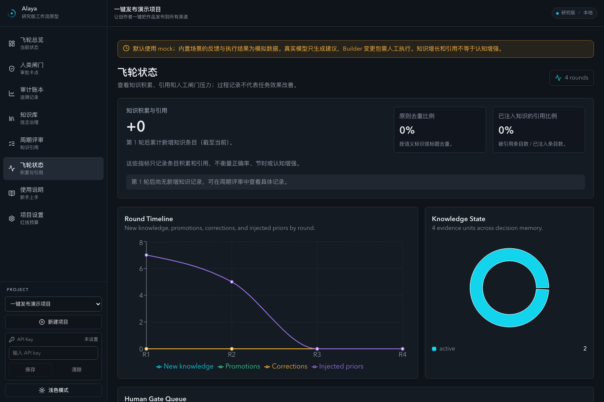
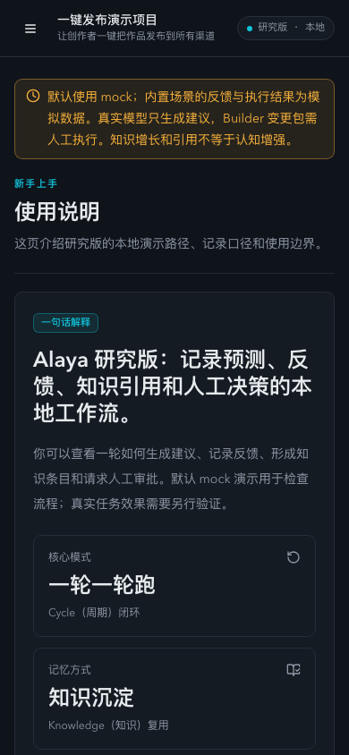

# Research release verification — 2026-10-15

Scope: `v0.1.0-research.1`, a single-user local research prototype. These are engineering and mock-UI checks, not new cognition, provider, search, long-run or formal-science experiments. The release tag identifies the final source; the work starts from `e0757e51` and preserves the existing fixed-search result.

## Environment

- macOS arm64; Node 24.15.0; npm 11.12.1; clean installation from the root lockfile.
- Built app and development server both used a fresh temporary SQLite database, mock providers, disabled background scheduler and disabled external notifications.
- Browser plugin was not available. Existing Playwright ran headless Chromium, without bringing a browser to the foreground.
- Desktop 1440 × 960 and mobile 390 × 844; light and dark modes inspected.

## Results

| Check | Observed result |
| --- | --- |
| Clean `npm ci` and lockfile dry run | PASS |
| Core tests | 71 / 71 |
| App tests | 269 / 269 |
| Script tests | 65 / 65 |
| Core and app typecheck | PASS |
| Principles guard | 12 / 12 |
| Secret scan | No high-confidence secrets found |
| `npm audit --audit-level=high` | 0 vulnerabilities reported |
| Vite + server build | PASS |
| Docker build | PASS; image construction only, no deployment or long run |
| Existing mock benchmark and evolution regression | PASS; synthetic regression fixtures only |
| Upgrade structural audit | Structural checks passed; live readiness remains incomplete and was not pursued |
| UI onboarding and approval path | PASS through existing UI controls |
| UI identity/content/overlay/console | Correct title, populated pages, no framework overlay, 0 console errors |
| Mobile navigation and layout | PASS; document width 390 px at 390 px viewport |
| Restart persistence | Projects, gates, knowledge and business rows preserved; FTS physical index pages were rebuilt normally |
| Backup and restore | Stopped app, restored to a fresh directory with the same DB filename, all 30 tables matched; integrity checks passed |
| Original working directory | HEAD, status, and all 102 pre-existing changed/untracked file hashes unchanged |
| New saved research evidence | 9 files copied byte-for-byte; 3 champion hashes match saved scores; M0/M1 arithmetic recomputed without models |

## Actual UI path

Create a new project → enter identity, hypothesis, metric and budgets → advance → direction gate waits → approve in the UI → advance operational stages → Distiller proposal waits → approve that proposal in the UI → read the persisted knowledge in the cycle review. Five role records, one prediction and one approved knowledge item were read back. The onboarding test previously expected knowledge before approval; it now explicitly verifies the proposal is absent before approval and present afterward.

Dashboard, status, guide, review and ledger pages were checked. Mobile navigation opened the guide. The UI now calls knowledge growth and reference ratios by their actual meaning and labels simulation/manual execution boundaries. A legacy external font request violated the existing CSP; the request was removed in favor of existing local/system fonts, without relaxing CSP.

## Direct regressions and dependency changes

- Scenario helpers and HTTP shortcuts reject non-development or real-provider configurations before database writes, including role/JSON overrides and route case/trailing-slash variants.
- Simulated approvals record `scenario`; real UI approvals still record `human`. No new strong-knowledge auto-approval was added, and historical rows were not rewritten.
- Loopback is the local default. Docker keeps its explicit internal bind address.
- SQLite 12.11.1 provides Node 24 compatibility. Root scripts explicitly declare their existing SQLite dependency rather than relying on workspace hoisting.
- Tailwind 3 depended on an unpatched braces advisory (GHSA-vfj7-8cjw-p6xm). The existing Tailwind 4 Vite plugin is now used with the same theme; unused typography/PostCSS setup was removed. Patched proxy-addr and source-map-js lock versions address their advisories. No audit exceptions or lowered thresholds were added.
- Automatic real-model CI was removed. CI retains mock tests, typechecks, audit, guard and builds.

## Limits

No real model calls, external notifications, new search, 24-hour run, production deployment, multi-user isolation test or paper submission was performed. Backup/restore evidence covers stopped-service recovery into a fresh destination; it does not claim hot backups or arbitrary live overwrite recovery. Frozen experiment results remain DEVELOPMENT, stopped, failed or inconclusive according to their original records. The release does not prove cognitive enhancement.
